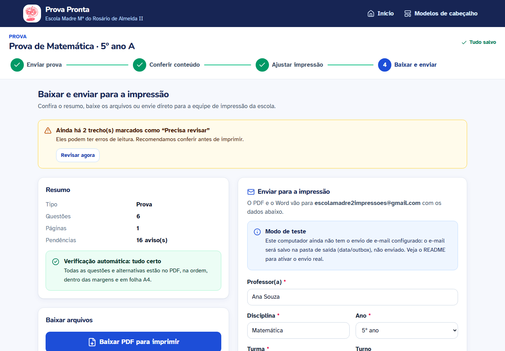

# Prova Pronta

**Organizador de provas, atividades e revisões para impressão** — feito para a Escola Municipalizada Madre Mª do Rosário de Almeida II (Santo Antônio de Jesus – BA).

O professor **cria a prova com inteligência artificial** a partir do que trabalhou em sala (conteúdos, plano de aula, fotos do caderno ou do livro), ou envia a prova do jeito que ela estiver (Word, PDF ou fotos). O Prova Pronta organiza questões, alternativas, textos de apoio e imagens no padrão da escola, o professor confere numa prévia com um ou dois cliques por ajuste e envia o PDF e o Word direto para a equipe de impressão. Provas criadas com IA vêm com **gabarito** separado, só para o professor.


> _In English:_ a FastAPI + React app that turns teachers' exams (DOCX, PDFs, scans and phone photos) into a faithful structured model, lets them review it side by side with the original, lays it out with python-docx using the school's header, previews the real PDF and e-mails it to the school's print room. See [the English summary](#in-english) and [docs/ARCHITECTURE.md](docs/ARCHITECTURE.md).

---

## O que ele faz

| Passo | O que acontece |
|---|---|
| **1. Criar ou enviar** | Escolha como começar (**Criar com IA**, formatar uma prova pronta, colar o texto ou digitar), depois *Prova*, *Atividade* ou *Revisão* e os dados da turma **com botões**: disciplina, ano (1º a 9º), turma (A, B, C, Única ou Outra), turno, tipo de avaliação e unidade, trimestre ou período. Para formatar, envie Word, PDF ou fotos das páginas (na ordem certa) ou cole o texto. |
| **2. Conferir** | A prova aparece **como vai ser impressa**. No topo, só os pontos que precisam de atenção, com respostas de um clique (“Sim, está certo”, “Inserir imagem”, “Trocar questão”). Ao tocar numa questão: editar texto, mais/menos linhas de resposta, imagem, “é texto de apoio”, juntar, apagar e, com IA, trocar/mais fácil/mais difícil e ver o gabarito. O original pode ser aberto ao lado. O **editor detalhado** (blocos, partes, recortes do original, desfazer/refazer) continua a um clique. |
| **3. Ajustar impressão (opcional)** | A diagramação é automática. Sai no **padrão das provas da escola**: cabeçalho em quadro com o logo, título como “Avaliação Final III Trimestre - Matemática 6º ano”, alternativas curtas lado a lado, linhas de resposta, moldura na página e frase de incentivo no final. Dá para mudar fonte, tamanho, espaçamento, 1 ou 2 colunas, margens e preto e branco. A prévia ao lado **é o próprio PDF**, e uma verificação automática avisa se faltou alguma questão ou alternativa, se algo saiu da margem, se passou de 4 páginas ou de 3 imagens por página, se a letra está pequena para o ano ou se uma questão depende de cores. |
| **4. Baixar e enviar** | Baixe o PDF (pronto para imprimir) e o Word (editável) ou envie os dois para **escolamadre2impressoes@gmail.com** com turma, quantidade de cópias, frente e verso e observações. O gabarito (provas criadas com IA) é baixado à parte e não vai para a impressão. |


| Início | Baixar e enviar | Modelos de cabeçalho |
|---|---|---|
|  |  |  |

### Criar com IA

Na tela inicial, **Criar com IA**: o professor escolhe disciplina, ano e tipo com botões, conta o que foi trabalhado (ou anexa o plano de aula, páginas do livro ou fotos do caderno) e escolhe quantidade de questões, tipos (objetivas, abertas ou misturadas) e nível. A IA segue um **manual de geração** tirado da análise de 119 provas reais da rede (estrutura por ano e disciplina, catálogo de tipos de questão, até 4 páginas, letra maior no 1º e 2º ano, imagens só quando indispensáveis) e devolve a prova no padrão da escola com gabarito e critérios. Na conferência, cada questão tem os botões **Trocar por outra**, **Mais fácil** e **Mais difícil**. Quando uma questão precisa de figura, a IA descreve a figura e o site pede que o professor a insira.

### A regra principal ao formatar: fidelidade

Ao formatar uma prova enviada, o Prova Pronta **organiza**; ele não reescreve enunciados, não corrige ortografia, não resolve questões e não renumera nada. A leitura usa regras determinísticas e, quando a IA está ligada, a IA confere **o papel de cada linha** (questão, alternativa, texto de apoio, cabeçalho…). Ela recebe as linhas numeradas e devolve só os papéis; o sistema reagrupa as mesmas partes e confere que o texto, lido em ordem, continua idêntico. Se algo não conferir, fica a leitura por regras. Quando não tem certeza, o site **pergunta** (“Esta linha começa a questão 4?”) em vez de “consertar”.

---

## Formatos suportados (de verdade)

| Formato | Como é lido | O que pode precisar de revisão |
|---|---|---|
| **Word (.docx)** — recomendado | Leitura direta do arquivo: texto, negrito/itálico/sublinhado, sobrescrito/subscrito, numeração automática do Word, imagens, tabelas (inclusive células mescladas), caixas de texto. | Equações do Word viram texto linear (ex.: `3/4+x²`) e são sinalizadas. Gráficos, SmartArt e desenhos do Word não são convertidos: aparecem como “recortar do original”. |
| **PDF com texto** | Leitura direta do texto, com estilos e duas colunas. Imagens, desenhos e tabelas viram recortes do próprio PDF. | Frações empilhadas são escritas em linha e sinalizadas. Tabelas ficam como imagem (texto não editável). |
| **PDF digitalizado e fotos (JPG/PNG)** | Reconhecimento de texto (OCR, Tesseract em português) com correção de rotação, inclinação e iluminação. Várias fotos = páginas da mesma prova. | Negrito, itálico e sublinhado não são reconhecidos em fotos. Expoentes e símbolos podem vir errados. Trechos com leitura incerta ficam destacados; páginas muito ruins são mantidas como imagem para não imprimir texto errado. Manuscrito não é suportado. |
| `.doc` antigo, HEIC (iPhone), arquivos com macro | Recusados, com explicação de como converter. | — |

Uma prova por vez. Envio em lote de várias provas ainda não existe.

---

## No ar para os professores

O site está no ar em **<https://provamadre-e34ad34b056f.herokuapp.com>**:

- **Servidor:** Heroku, plano Basic (sempre ligado), pago com o crédito do GitHub Student Developer Pack. Cada envio para a `main` publica sozinho depois que o CI passa.
- **Banco de dados:** PostgreSQL gratuito no Neon (AWS US East, perto do servidor) — guarda provas em andamento, arquivos e modelos de cabeçalho.
- **Acesso:** um **código da escola** que cada professor digita uma vez por aparelho.

O passo a passo completo, inclusive o caminho com servidor próprio (Oracle ou qualquer Ubuntu), está em **[docs/DEPLOY.md](docs/DEPLOY.md)**. Para usar só num computador da escola, siga a instalação abaixo.

---

## Instalação no Windows (um computador)

**Programas necessários** (instale uma vez, pelo PowerShell ou pelo site oficial de cada um):

```bash
winget install Python.Python.3.12
```
```bash
winget install OpenJS.NodeJS.LTS
```
```bash
winget install UB-Mannheim.TesseractOCR
```
```bash
winget install TheDocumentFoundation.LibreOffice
```

- **Tesseract** lê fotos e PDFs digitalizados (sem ele, essas páginas entram como imagem).
- **LibreOffice** gera o PDF a partir do Word. Sem ele, o Prova Pronta usa o Microsoft Word, se estiver instalado.

**Depois**, na pasta do projeto:

1. Clique duas vezes em **`Instalar Prova Pronta.bat`** (prepara tudo e baixa os dados de português do OCR).
2. Clique duas vezes em **`Iniciar Prova Pronta.bat`**. O navegador abre em <http://localhost:8000>. Deixe a janela preta aberta enquanto usa.

### Configuração (`.env`)

O instalador cria o arquivo `.env` a partir de [`.env.example`](.env.example). Por padrão **nenhum e-mail é enviado**: eles ficam salvos em `data/outbox` (modo de teste, e a tela avisa isso). Para enviar de verdade pelo Gmail:

1. Use uma conta Google da escola com verificação em duas etapas.
2. Crie uma *senha de app* em <https://myaccount.google.com/apppasswords>.
3. No `.env`: `MAIL_MODE=smtp`, `SMTP_USERNAME=conta@gmail.com`, `SMTP_PASSWORD=senha-de-app`.

**Inteligência artificial:** cole chaves grátis de um ou mais serviços (`GEMINI_API_KEY`, `GROQ_API_KEY`, `MISTRAL_API_KEY`, `OPENROUTER_API_KEY`). Eles formam uma fila com troca automática: quando um atinge o limite do dia, o próximo responde. O Claude pelo Heroku (`INFERENCE_URL`/`INFERENCE_KEY`, add-on *Managed Inference*) entra em primeiro lugar quando estiver disponível. Passo a passo em [docs/DEPLOY.md](docs/DEPLOY.md). Sem nenhuma chave, a IA fica desligada, nada sai do computador e o site funciona com a leitura por regras.

---

## Privacidade e segurança

- O conteúdo só vai à IA quando ela está ligada no servidor, e a tela diz para onde vai e se o serviço pode usar o conteúdo (serviços grátis podem: a tela pede para não colocar nomes de alunos). Cada prova enviada pode ser lida **sem IA**. Instruções escritas dentro dos documentos são tratadas como conteúdo, nunca como comandos. No servidor, os dados ficam no seu banco PostgreSQL.
- Na internet, o site exige o código da escola em toda a API, limita tentativas de login e envios por hora e usa HTTPS.
- Arquivos enviados são tratados como não confiáveis: o tipo é identificado pelo conteúdo, há limites de tamanho/páginas/resolução, arquivos com macro são recusados e há proteção contra arquivos compactados maliciosos.
- Provas não alteradas há mais de 72 h (configurável) são apagadas automaticamente, junto com os e-mails de teste.
- Os registros (logs) nunca guardam o conteúdo das provas — só identificadores aleatórios e tempos.
- Senhas e chaves ficam só no `.env` do servidor, nunca no navegador.

---

## Limitações conhecidas

- Fórmulas complexas, gráficos e diagramas do Word não são convertidos em texto: a ferramenta “Recortar do original” preserva como imagem.
- Tabelas de PDFs e fotos ficam como imagem (não editáveis); tabelas de arquivos Word são editáveis na impressão, mas a edição de células na conferência ainda não existe.
- OCR não reconhece negrito/itálico/sublinhado nem escrita à mão; expoentes podem ser lidos como números comuns (o sistema avisa).
- A paginação do Word baixado pode variar um pouco se ele for aberto em outro programa; o PDF é a referência para impressão.
- Acesso por um código único da escola, sem contas individuais por professor.
- Um único servidor por instalação (as tarefas em segundo plano ficam na memória do processo).
- IA testada com respostas simuladas e com um servidor local que imita a API do Heroku; ainda não foi validada contra o Claude real.
- PDF: alternativas em grade com texto quebrando em duas linhas podem misturar o fim de uma alternativa com a vizinha (raro; aparece na conferência).

---

## Desenvolvimento

```
backend/   FastAPI · extração (DOCX, PDF, OCR) · estruturação · python-docx · e-mail · IA opcional
frontend/  React 19 + TypeScript + Vite + Tailwind 4
samples/   provas sintéticas (geradas) + expected.json
docs/      arquitetura, implantação e capturas de tela
scripts/   setup.ps1 · start.ps1 · dev.ps1 (Windows)
deploy/    docker-compose + Caddy + scripts do servidor
Dockerfile imagem única: API + site + LibreOffice + Tesseract
```

Ferramentas de desenvolvimento e testes: `backend/.venv/Scripts/python -m pip install -e "backend[dev]"`.

Modo desenvolvimento (API com recarga automática em :8000 e site em :5173):

```bash
powershell -ExecutionPolicy Bypass -File scripts/dev.ps1
```

Testes:

```bash
backend/.venv/Scripts/python -m pytest backend/tests
```
```bash
npm --prefix frontend test
```

Os testes de OCR e de PDF são pulados automaticamente se Tesseract ou LibreOffice/Word não estiverem instalados. Para recriar as provas de exemplo: `backend/.venv/Scripts/python samples/generate_samples.py`.

A API documentada fica em <http://localhost:8000/api/docs>. Decisões técnicas, modelo de dados e bibliotecas (com licenças) estão em [docs/ARCHITECTURE.md](docs/ARCHITECTURE.md).

---

## In English

**Prova Pronta** (“Exam Ready”) organises school exams for printing while keeping their content untouched.

- **Input:** DOCX (direct XML extraction, Word auto-numbering resolved, equations linearised and flagged), text PDFs (pdfplumber, two-column reading order, stacked fractions, crops of figures/tables) and scans/photos (Tesseract with deskew, lighting correction, a second pass for skipped lines, unreadable areas kept as images).
- **Structure:** deterministic segmentation into header, instructions, support texts, questions and alternatives, keeping labels verbatim and recording doubts as review issues. Every part keeps its provenance (page + bounding box) and the originally extracted runs, so manual corrections stay visible and reversible.
- **Review UI:** side-by-side with the original, highlight-on-select, crop tool, rich-text editing limited to exam formatting, undo/redo, autosave with offline recovery.
- **Output:** a single layout engine — python-docx — produces the school-standard Word file; LibreOffice (or MS Word) converts it to PDF; the preview *is* that PDF, and automatic checks compare it with the model (missing/duplicated/reordered questions, margins, A4, orphaned question numbers).
- **Delivery:** e-mail to the print room via SMTP (local outbox by default).
- **Hosting:** one Docker image (API, web app, LibreOffice, Tesseract) on Heroku's container stack (or behind Caddy on any Ubuntu VM), PostgreSQL on Neon as the durable store (local disk is a cache, so ephemeral hosts work too), a shared school access code with signed cookies, and CI that builds and smoke-tests the image.
- **AI (a fallback chain of free OpenAI-compatible services — Gemini, Groq, Mistral, OpenRouter — with Claude via Heroku first when available):** creates exams from the teacher's content following a generation manual distilled from 119 real exams (with a teacher-only answer key), and labels each line of an uploaded exam by number; parts are regrouped deterministically and the text signature must not change, otherwise the rule-based reading is kept. Document text is always sent as data. Without AI configured, everything still works rule-based.

