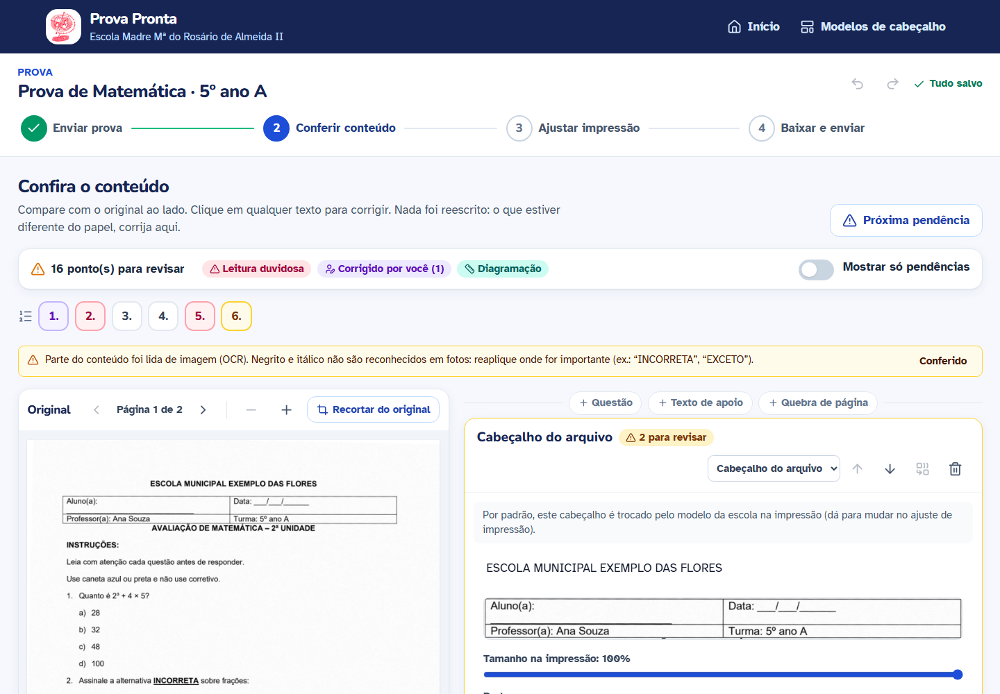
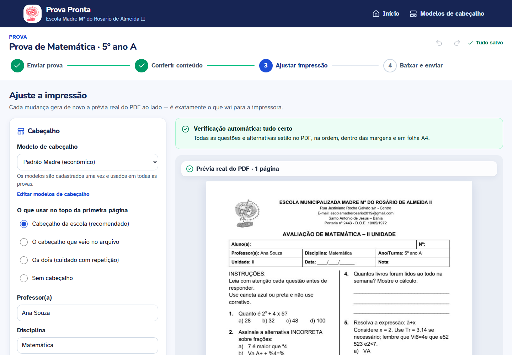
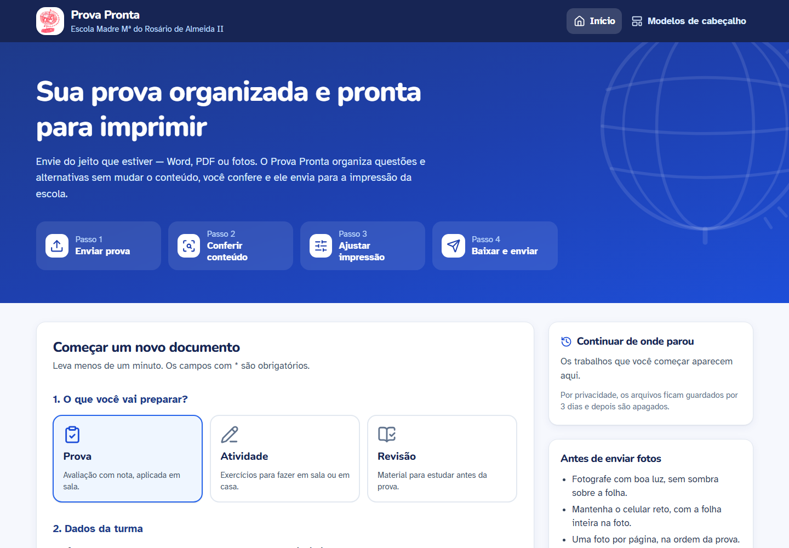
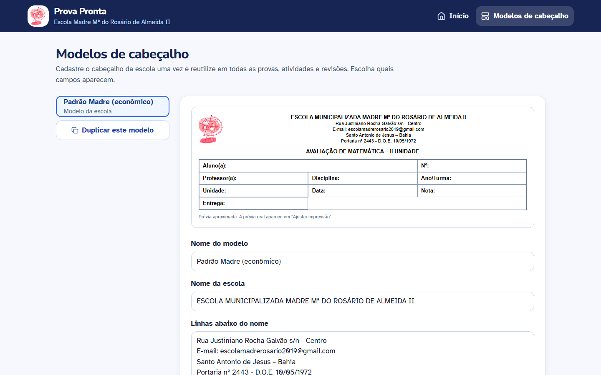

# Prova Pronta

**Organizador de provas, atividades e revisões para impressão** — feito para a Escola Municipalizada Madre Mª do Rosário de Almeida II (Santo Antônio de Jesus – BA).

O professor envia a prova do jeito que ela estiver (Word, PDF ou fotos), o Prova Pronta separa questões, alternativas, textos de apoio e imagens **sem reescrever nada**, o professor confere ao lado do original, ajusta a impressão com o cabeçalho da escola e envia o PDF e o Word direto para a equipe de impressão.



> _In English:_ a FastAPI + React app that turns teachers' exams (DOCX, PDFs, scans and phone photos) into a faithful structured model, lets them review it side by side with the original, lays it out with python-docx using the school's header, previews the real PDF and e-mails it to the school's print room. See [the English summary](#in-english) and [docs/ARCHITECTURE.md](docs/ARCHITECTURE.md).

---

## O que ele faz

| Passo | O que acontece |
|---|---|
| **1. Enviar prova** | Escolha *Prova*, *Atividade* ou *Revisão*, preencha professor(a), disciplina, ano, turma, turno e unidade. Envie um arquivo Word, um PDF ou fotos das páginas (na ordem certa) — ou cole o texto, ou crie do zero. |
| **2. Conferir conteúdo** | O original fica ao lado do conteúdo organizado. Ao clicar num trecho, a mesma região é destacada no original. Trechos duvidosos aparecem marcados; correções suas ficam identificadas como “corrigido por você”, com o texto extraído a um clique. Dá para editar texto (negrito, itálico, sublinhado, x², H₂O), números e alternativas, mover/separar/juntar blocos, trocar imagens de questão, recortar figuras do original e definir espaços de resposta. Desfazer e refazer a qualquer momento. |
| **3. Ajustar impressão** | Cabeçalho da escola (ou o do arquivo), fonte, tamanho, espaçamento, 1 ou 2 colunas, margens, numeração de páginas, rodapé, preto e branco. A prévia ao lado **é o próprio PDF**, e uma verificação automática avisa se faltou alguma questão ou alternativa, se algo saiu da margem ou se o número de uma questão ficou sozinho no fim da página. |
| **4. Baixar e enviar** | Baixe o PDF (pronto para imprimir) e o Word (editável) ou envie os dois para **escolamadre2impressoes@gmail.com** com turma, quantidade de cópias, frente e verso e observações. |



| Início | Baixar e enviar | Modelos de cabeçalho |
|---|---|---|
|  |  |  |

### A regra principal: fidelidade

O Prova Pronta **organiza**; ele não escreve provas. Ele não reescreve enunciados, não corrige ortografia, não resolve questões, não troca nem reordena alternativas e não renumera nada: os números e letras ficam exatamente como estavam. Quando não tem certeza de algo, ele **avisa** em vez de “consertar”. A organização é feita por regras determinísticas — a IA é opcional e só sugere.

---

## Formatos suportados (de verdade)

| Formato | Como é lido | O que pode precisar de revisão |
|---|---|---|
| **Word (.docx)** — recomendado | Leitura direta do arquivo: texto, negrito/itálico/sublinhado, sobrescrito/subscrito, numeração automática do Word, imagens, tabelas (inclusive células mescladas), caixas de texto. | Equações do Word viram texto linear (ex.: `3/4+x²`) e são sinalizadas. Gráficos, SmartArt e desenhos do Word não são convertidos: aparecem como “recortar do original”. |
| **PDF com texto** | Leitura direta do texto, com estilos e duas colunas. Imagens, desenhos e tabelas viram recortes do próprio PDF. | Frações empilhadas são escritas em linha e sinalizadas. Tabelas ficam como imagem (texto não editável). |
| **PDF digitalizado e fotos (JPG/PNG)** | Reconhecimento de texto (OCR, Tesseract em português) com correção de rotação, inclinação e iluminação. Várias fotos = páginas da mesma prova. | Negrito, itálico e sublinhado não são reconhecidos em fotos. Expoentes e símbolos podem vir errados. Trechos com leitura incerta ficam destacados; páginas muito ruins são mantidas como imagem para não imprimir texto errado. Manuscrito não é suportado. |
| `.doc` antigo, HEIC (iPhone), arquivos com macro | Recusados, com explicação de como converter. | — |

Uma prova por vez. Envio em lote de várias provas ainda não existe.

---

## Instalação no Windows

**Programas necessários** (instale uma vez, pelo PowerShell ou pelo site oficial de cada um):

```bash
winget install Python.Python.3.12
```
```bash
winget install OpenJS.NodeJS.LTS
```
```bash
winget install UB-Mannheim.TesseractOCR
```
```bash
winget install TheDocumentFoundation.LibreOffice
```

- **Tesseract** lê fotos e PDFs digitalizados (sem ele, essas páginas entram como imagem).
- **LibreOffice** gera o PDF a partir do Word. Sem ele, o Prova Pronta usa o Microsoft Word, se estiver instalado.

**Depois**, na pasta do projeto:

1. Clique duas vezes em **`Instalar Prova Pronta.bat`** (prepara tudo e baixa os dados de português do OCR).
2. Clique duas vezes em **`Iniciar Prova Pronta.bat`**. O navegador abre em <http://localhost:8000>. Deixe a janela preta aberta enquanto usa.

### Configuração (`.env`)

O instalador cria o arquivo `.env` a partir de [`.env.example`](.env.example). Por padrão **nenhum e-mail é enviado**: eles ficam salvos em `data/outbox` (modo de teste, e a tela avisa isso). Para enviar de verdade pelo Gmail:

1. Use uma conta Google da escola com verificação em duas etapas.
2. Crie uma *senha de app* em <https://myaccount.google.com/apppasswords>.
3. No `.env`: `MAIL_MODE=smtp`, `SMTP_USERNAME=conta@gmail.com`, `SMTP_PASSWORD=senha-de-app`.

**IA opcional (Gemini):** preencha `GEMINI_API_KEY` para liberar o botão “Revisar com IA”. Cada uso pede confirmação, porque o conteúdo da prova é enviado ao Google. Sem a chave, nada sai do computador.

---

## Privacidade e segurança

- Tudo roda no computador da escola; nada é enviado a serviços externos sem ação explícita (e-mail para a impressão ou IA com confirmação).
- Arquivos enviados são tratados como não confiáveis: o tipo é identificado pelo conteúdo, há limites de tamanho/páginas/resolução, arquivos com macro são recusados e há proteção contra arquivos compactados maliciosos.
- Provas não alteradas há mais de 72 h (configurável) são apagadas automaticamente, junto com os e-mails de teste.
- Os registros (logs) nunca guardam o conteúdo das provas — só identificadores aleatórios e tempos.
- Senhas e chaves ficam só no `.env` do servidor, nunca no navegador.

---

## Limitações conhecidas

- Fórmulas complexas, gráficos e diagramas do Word não são convertidos em texto: a ferramenta “Recortar do original” preserva como imagem.
- Tabelas de PDFs e fotos ficam como imagem (não editáveis); tabelas de arquivos Word são editáveis na impressão, mas a edição de células na conferência ainda não existe.
- OCR não reconhece negrito/itálico/sublinhado nem escrita à mão; expoentes podem ser lidos como números comuns (o sistema avisa).
- A paginação do Word baixado pode variar um pouco se ele for aberto em outro programa; o PDF é a referência para impressão.
- Sem login: pensado para uso local. Para hospedar, coloque atrás de autenticação (veja a arquitetura).
- Assistente de IA testado com respostas simuladas; não foi validado contra a API real nesta versão.

---

## Desenvolvimento

```
backend/   FastAPI · extração (DOCX, PDF, OCR) · estruturação · python-docx · e-mail · IA opcional
frontend/  React 19 + TypeScript + Vite + Tailwind 4
samples/   provas sintéticas (geradas) + expected.json
docs/      arquitetura e capturas de tela
scripts/   setup.ps1 · start.ps1 · dev.ps1
```

Modo desenvolvimento (API com recarga automática em :8000 e site em :5173):

```bash
powershell -ExecutionPolicy Bypass -File scripts/dev.ps1
```

Testes:

```bash
backend/.venv/Scripts/python -m pytest backend/tests
```
```bash
npm --prefix frontend test
```

Os testes de OCR e de PDF são pulados automaticamente se Tesseract ou LibreOffice/Word não estiverem instalados. Para recriar as provas de exemplo: `backend/.venv/Scripts/python samples/generate_samples.py`.

A API documentada fica em <http://localhost:8000/api/docs>. Decisões técnicas, modelo de dados e bibliotecas (com licenças) estão em [docs/ARCHITECTURE.md](docs/ARCHITECTURE.md).

---

## In English

**Prova Pronta** (“Exam Ready”) organises school exams for printing while keeping their content untouched.

- **Input:** DOCX (direct XML extraction, Word auto-numbering resolved, equations linearised and flagged), text PDFs (pdfplumber, two-column reading order, stacked fractions, crops of figures/tables) and scans/photos (Tesseract with deskew, lighting correction, a second pass for skipped lines, unreadable areas kept as images).
- **Structure:** deterministic segmentation into header, instructions, support texts, questions and alternatives, keeping labels verbatim and recording doubts as review issues. Every part keeps its provenance (page + bounding box) and the originally extracted runs, so manual corrections stay visible and reversible.
- **Review UI:** side-by-side with the original, highlight-on-select, crop tool, rich-text editing limited to exam formatting, undo/redo, autosave with offline recovery.
- **Output:** a single layout engine — python-docx — produces the school-standard Word file; LibreOffice (or MS Word) converts it to PDF; the preview *is* that PDF, and automatic checks compare it with the model (missing/duplicated/reordered questions, margins, A4, orphaned question numbers).
- **Delivery:** e-mail to the print room via SMTP (local outbox by default).
- **Optional AI:** Gemini only suggests labels or character-level OCR fixes; responses are strictly validated and applied one by one after explicit consent.

