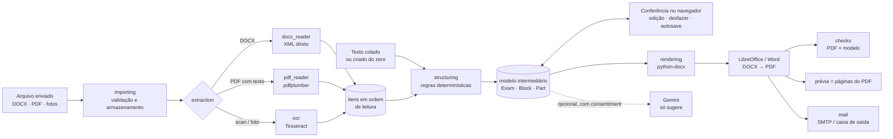

# Arquitetura

Este documento explica como o Prova Pronta funciona por dentro, por que as principais decisões foram tomadas e quais são os limites de cada parte. Para instalar e usar, veja o [README](../README.md).

## Visão geral



Um único processo FastAPI serve a API (`/api/*`) e o site compilado. Cada prova é uma pasta em `data/projects/<uuid>/` — não há banco de dados.

| Módulo (`backend/app/`) | Responsabilidade |
|---|---|
| `importing/` | Validação dos envios (assinatura do arquivo, limites, macros, zip-bomb), armazenamento atômico por projeto, limpeza por tempo de retenção. |
| `extraction/` | Leitura direta de DOCX e PDF, OCR de imagens, ordem de leitura (colunas), páginas do original para a conferência, recortes. |
| `structuring/` | Regras que agrupam itens em cabeçalho, instruções, textos de apoio, questões e alternativas. Também processa texto colado. |
| `domain/` | Modelo intermediário (Pydantic) compartilhado por todas as etapas. |
| `rendering/` | Geração do DOCX (python-docx), conversão para PDF, prévias, verificações automáticas, fontes disponíveis. |
| `mail/` | Montagem e envio do e-mail para a impressão. |
| `ai/` | Assistente opcional (Gemini) com validação estrita das respostas. |
| `api/`, `jobs.py`, `main.py` | Rotas HTTP, tarefas em segundo plano com progresso, app e arquivos estáticos. |

No frontend (`frontend/src/`): `api/` (cliente e tipos espelhando o modelo), `store/` (estado da prova com desfazer/refazer e autosave), `lib/exam-ops.ts` (operações de edição puras e testadas), `pages/` (as quatro etapas e os modelos de cabeçalho) e `components/` (base acessível).

## Decisões principais

### 1. Um único motor de diagramação: python-docx → PDF

A prova é montada **uma vez**, como DOCX, com python-docx. O PDF é a conversão desse DOCX (LibreOffice em modo headless; Microsoft Word via COM como alternativa no Windows), e a prévia mostrada ao usuário são as **páginas desse PDF** rasterizadas com pypdfium2. Assim:

- a prévia e o PDF impresso são o mesmo arquivo (o download usa o mesmo `render_id` da prévia);
- o Word entregue segue o padrão da escola, como pedido, e continua editável;
- não existem dois motores (HTML/ReportLab + DOCX) com paginações divergentes.

A paginação usa regras que Word e LibreOffice respeitam: *manter com o próximo* encadeia número, enunciado, imagens e alternativas; *manter linhas juntas* evita partir parágrafos; linhas de tabela não quebram; controle de viúvas/órfãs. Questões maiores que uma página podem ser liberadas para dividir (o enunciado continua preso às primeiras alternativas), e há “começar em nova página” manual.

O LibreOffice foi escolhido como conversor principal porque é gratuito, roda igual no Windows e num container Linux — a prévia local será a mesma de uma futura hospedagem. Conversões são serializadas (um perfil isolado, com tempo limite).

### 2. Fidelidade antes de tudo

- **Rótulos verbatim:** `number` e `label` guardam “01 –”, “Questão 3:”, “(B)” exatamente como vieram; nada é renumerado. Ao transformar uma questão em outro tipo, o número volta para o texto em vez de sumir.
- **Proveniência:** cada `Part` sabe de qual arquivo, página e região (`bbox` normalizada) veio e por qual método (`docx`, `pdf_text`, `ocr`, `crop`, `paste`, `manual`). Isso alimenta o destaque no original.
- **Snapshot do extraído:** `original_runs` guarda o que foi lido. A interface compara com `runs` para mostrar “Corrigido por você” e oferecer “voltar ao extraído”.
- **Dúvidas viram `Issue`, nunca correções silenciosas:** numeração com saltos, alternativas faltando ou repetidas, leitura OCR com baixa confiança (com as palavras incertas destacadas), fórmula linearizada, tabela preservada como imagem, imagem que pode ser da questão seguinte, duas colunas… O usuário marca como conferido.
- **Nada some:** texto que o OCR não consegue ler é preservado como recorte da imagem; páginas muito ruins (confiança média < 45%) inteiras viram imagem em vez de “chutes”; DOCX com elementos não convertíveis (gráficos, SmartArt, formas, objetos OLE sem prévia) geram um marcador “recortar do original”.
- **Três sinais distintos na interface:** divergências de extração (vermelho/âmbar), correções manuais (violeta) e mudanças de diagramação (verde-azulado). O `changes[]` do modelo registra cada alteração com o tipo `content`, `structure` ou `layout`.

### 3. Estruturação determinística (sem IA)

As regras (`structuring/patterns.py` e `segmenter.py`) reconhecem padrões de provas brasileiras — `1)`, `01.`, `01 –`, `Questão 3`, `(4)`; alternativas `a)`, `(B)`, `A.`, `( )`; seções de instruções; campos de cabeçalho (`Nome:`, `Turma:`…); textos de apoio (“Leia o texto…”, “para as questões 3 e 4”). Alguns cuidados:

- a numeração é **sensível à sequência**: “10 - 3 = 7” não vira questão 10; um número muito fora da sequência fica como texto e é sinalizado;
- instruções numeradas antes das questões não roubam a numeração;
- alternativas na mesma linha (“a) 2  b) 3  c) 4”) são separadas e sinalizadas;
- linhas de sublinhado e parágrafos vazios viram espaços de resposta.

### 4. Ordem de leitura e OCR

- **Duas colunas:** a calha é a faixa vertical que fica vazia pela **maior sequência ininterrupta de linhas**; isso funciona mesmo abaixo de cabeçalhos largos e ignora áreas apenas esparsas ao lado de linhas curtas. Uma validação final exige linhas dos dois lados e mais linhas de coluna que frases cruzando a faixa — evitando ler uma prova de coluna única “em duas colunas”.
- **PDF com texto:** palavras do pdfplumber com estilo pelo nome da fonte; sublinhado detectado por traços sob as palavras (descartando linhas de resposta e barras de fração); frações empilhadas reescritas como `a/b`; sobrescrito/subscrito por tamanho e linha de base.
- **OCR:** orientação (OSD), correção de inclinação por perfil de projeção, normalização de iluminação, ampliação de imagens pequenas. Uma **segunda passagem** relê, uma a uma, áreas com tinta que a análise de layout do Tesseract ignorou (alternativas curtas como “a) 28” eram descartadas). Lacunas “____” são reconstruídas a partir dos traços quando não há nada escrito acima. Figuras e tabelas viram recortes e “absorvem” rótulos colados a elas (títulos e eixos de gráficos).

### 5. Verificação do PDF exportado

`rendering/checks.py` relê o PDF (na ordem de leitura de colunas) e confere contra o modelo: cada questão e alternativa aparece uma única vez e na ordem; nada fora das margens; páginas A4; número de questão isolado na última linha da página; questões que ocupam mais de uma página; imagens reduzidas demais para caber na coluna. Os avisos aparecem ao lado da prévia com atalho para a questão.

### 6. IA opcional e segura

Desligada sem `GEMINI_API_KEY` (pacote `google-genai` é um extra opcional). Quando ligada, cada chamada exige consentimento explícito na interface e no backend (`consent: true`). O modelo:

- recebe o conteúdo da prova como **dados** (o prompt diz para ignorar instruções contidas nele);
- responde em JSON com schema e só pode **rotular partes por id** ou propor correções **de caracteres** de OCR;
- tem a resposta validada: ids desconhecidos, faltando ou fora de ordem invalidam tudo; sugestões que não conferem com o texto atual, que reescrevem (similaridade < 85%) ou mudam muito o tamanho são descartadas;
- nunca aplica nada sozinho: o professor aceita sugestão por sugestão.

### 7. Armazenamento e tarefas

Sem banco: `project.json` com escrita atômica e trava por projeto, mais pastas de originais, páginas, recortes e renders. Extração e renderização rodam num pool de threads com progresso persistido (o usuário pode recarregar a página). Salvar a prova usa controle otimista por `revision` (conflito entre abas é detectado). O navegador guarda uma cópia local de alterações não salvas para recuperar após queda de conexão.

## Modelo de dados (resumo)

```
Project ─ id (uuid) · revision · sources[] · job · last_render_id · sent[]
  └─ Exam ─ meta (tipo, disciplina, ano, turma, professor…) · layout · header · changes[] · document_issues[]
       └─ Block ─ kind: original_header | instructions | support_text | question | free | page_break
            │      number (verbatim) · answer_space · page_break_before · allow_split · alternatives_inline · issues[]
            └─ Part ─ kind: paragraph | alternative | image | crop | table | answer_space
                   runs[] (texto + negrito/itálico/sublinhado/sup/sub) · original_runs[] · label (verbatim)
                   asset_id · width_cm · width_pct · rows (tabela) · provenance{source, page, bbox, method, confidence} · issues[]
```

## Dependências

Escolhidas pela licença permissiva, suporte a Windows sem compilação e documentação oficial verificada.

| Biblioteca / ferramenta | Uso | Licença | Observações |
|---|---|---|---|
| FastAPI, Uvicorn, Pydantic | API, validação | MIT / BSD | — |
| python-docx 1.2 | ler e gerar DOCX | MIT | Não expõe equações, numeração e caixas de texto: tratados no XML. |
| pdfplumber (pdfminer.six) | texto, fontes e posições de PDFs | MIT | Não faz OCR; tabelas usadas só para localizar regiões. |
| pypdfium2 | renderizar páginas de PDF | Apache-2.0 / BSD-3 | Wheels para Windows incluídos. |
| Tesseract 5 + `por` (tessdata_best) | OCR | Apache-2.0 | Binário instalado à parte (UB Mannheim no Windows, apt no Linux). |
| pytesseract, OpenCV (headless), NumPy, Pillow | pré-processamento e chamada do OCR | Apache-2.0 / BSD / HPND | — |
| LibreOffice | DOCX → PDF | MPL-2.0 | Alternativa: Microsoft Word via pywin32 (só Windows). |
| google-genai (opcional) | Gemini | Apache-2.0 | Modelo configurável (`GEMINI_MODEL`). |
| React 19, React Router, Zustand | interface e estado | MIT | — |
| TipTap 3 | edição rica limitada à formatação de prova | MIT | — |
| dnd-kit, lucide-react | ordenar páginas, ícones | MIT / ISC | — |
| Tailwind CSS 4, Vite | estilos e build | MIT | — |
| Nunito, Atkinson Hyperlegible (@fontsource) | tipografia (servidas localmente) | OFL-1.1 | Atkinson foi criada para baixa visão. |

## Segurança e privacidade

- Envios são não confiáveis: tipo pela assinatura, limites de tamanho/páginas/megapixels (proteção contra *decompression bomb*), DOCX com macro recusado, verificação de entradas do ZIP, nomes aleatórios em disco, nomes de arquivo higienizados.
- IDs de projeto são UUIDs aleatórios; a API não lista projetos (o navegador guarda só os ids que ele mesmo criou).
- Cabeçalhos de segurança (`nosniff`, `no-referrer`, `SAMEORIGIN`) e `Cache-Control: no-store` nas respostas da API.
- Logs com método, caminho (só ids), status e tempo — nunca conteúdo.
- Retenção configurável com limpeza na inicialização e a cada hora.
- Credenciais só no `.env` do servidor.

**Para hospedar:** adicionar autenticação (ex.: login da escola ou proxy com SSO), HTTPS, um container com LibreOffice + Tesseract (`apt install libreoffice-writer tesseract-ocr tesseract-ocr-por fonts-liberation`) e volume persistente para `data/templates`. A estrutura já permite isso sem mudanças no código.

## Testes

- **Backend (pytest):** validação de envios; extração das provas sintéticas de `samples/` comparada com `expected.json` (nenhuma questão/alternativa perdida, duplicada ou fora de ordem; acentos e símbolos; formatação; imagem e tabela na questão certa; OCR com dúvidas sinalizadas; foto ilegível preservada como imagem); estruturação; DOCX gerado; PDF exportado em 1 e 2 colunas (A4, completo, em ordem, dentro das margens); e-mail via servidor SMTP local; IA com respostas simuladas maliciosas ou incompletas; fluxo completo da API até o e-mail.
- **Frontend (Vitest):** operações de edição que não podem perder texto e conversão de formatação do editor.
- **Manual:** fluxo completo no navegador (envio, conferência com correção, ajuste em 2 colunas, envio para a caixa de saída), em desktop e celular.
